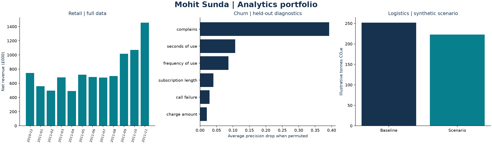

# Mohit Sunda | Analytics portfolio

**Python, SQL and business analysis, from source data to a reviewable decision.**

I hold an MSc in Business Analytics and Consultancy from Heriot-Watt University,
completed with merit. This portfolio presents three independent case studies that
connect data quality, commercial questions and practical decisions.



## Start here

| Project | Business question | Evidence | Main skills |
| --- | --- | --- | --- |
| [01 · UK retail performance](projects/01_uk_retail/README.md) | Where do revenue and customer activity need attention? | 541,909 public transaction rows, revenue reconciliation, RFM and cohorts | Python, DuckDB SQL, KPI design, Power BI handoff |
| [02 · Customer retention](projects/02_customer_retention/README.md) | Which cases should a limited retention team review first? | Three model baselines, grouped train/validation/test split, batch scoring | scikit-learn, leakage controls, decision thresholds |
| [03 · Green logistics](projects/03_green_logistics/README.md) | Which lane changes fit cost and service constraints? | 6,000 synthetic shipments, all 256 consolidation combinations | Optimisation, requirements, acceptance criteria, change planning |

Read the [full-data retail memo](artifacts/full/retail_case_study.md),
[churn model card](artifacts/full/churn_model_card.md) and
[logistics business case](artifacts/full/logistics_business_case.md).
The [static recruiter showcase](docs/index.html) can be served locally or published to GitHub Pages.

The public repository publishes aggregate public-source results and artificial demos. Detailed RFM records, prediction rows and raw sources are generated locally. See [PRIVACY.md](PRIVACY.md).

These are portfolio studies, not work delivered to a client. Logistics figures are
synthetic. Public data is historical. Predictive results and scenario estimates do
not establish a realised business impact.

## Run locally

Use Python 3.12. Commands below work from the repository root.

```bash
python -m venv .venv
# macOS / Linux
source .venv/bin/activate
# Windows PowerShell instead: .venv\Scripts\Activate.ps1
python -m pip install -r requirements-dev.txt
python -m pip install -e . --no-deps
portfolio build --source demo
streamlit run streamlit_app.py
```

Open the local URL printed by Streamlit. Precomputed full and demo outputs are
included, so the dashboard works immediately after installation. The offline demo generates deterministic synthetic retail, churn and logistics data. Demo totals and model scores describe those artificial inputs only. Full mode downloads the original public UCI sources locally.

### Rebuild from the full public sources

```bash
portfolio download --dataset all
portfolio build --source full
```

The full retail download is about 23 MB. XLSX parsing can take a minute depending on
your computer. Source archives and extracted files are checked against recorded SHA-256 hashes. Raw downloads, individual-customer exports, the local warehouse, full fact Parquet and model pickles are excluded from Git. The public dashboard reads aggregates.

### Score a CSV

```bash
portfolio score --model artifacts/full/churn_model.joblib --input examples/scoring_input.csv --output artifacts/scored_customers.csv
```

First rebuild the full run to create the trusted local model file. The example contains five invented predictor rows. Input names and categories are validated.

### Verify

```bash
ruff check .
ruff format --check .
pytest -q
python scripts/execute_notebooks.py
python scripts/build_showcase.py
```

CI runs the offline build, static checks, tests and all three notebooks on Python
3.12. Test data never requires a network connection. No CI pass is claimed until a
workflow actually runs in GitHub.

## What is included

- Packaged Python modules and CLI, with pinned runtime and development dependencies.
- Executable analytical SQL and a local DuckDB warehouse created during builds.
- Four-page Streamlit app with filters, downloadable results and scenario controls.
- Three executed notebooks, quality checks, generated charts and decision memos.
- Full-data aggregate CSV exports and reproducible synthetic offline demos.
- [Power BI handoff](powerbi/README.md): Power Query, DAX measures and report specification.
- Docker configuration, CI and an optional GitHub Pages deployment workflow.
- [Data dictionary](docs/data_dictionary.md), [architecture](docs/architecture.md),
  [operating guide](docs/operations.md) and [interview walkthroughs](docs/interview_guide.md).

## Repository layout

| Path | Purpose |
| --- | --- |
| `src/portfolio/` | Pipeline, model, optimiser, reporting and CLI |
| `src/portfolio/queries/` | Executable DuckDB SQL |
| `projects/` | Business problem, acceptance criteria, decisions and limitations |
| `notebooks/` | Executed project walkthroughs |
| `src/portfolio/synthetic.py` | Seeded artificial retail and churn inputs |
| `examples/` | Five invented scoring inputs |
| `data/sources.json` | Source URLs and integrity hashes |
| `artifacts/full/` | Computed results from the full public retail and churn sources |
| `artifacts/demo/` | Offline sample results |
| `tests/` | Financial, leakage, optimisation, pipeline and app checks |
| `powerbi/` | BI model handoff, no fabricated PBIX file |
| `docs/` | Static showcase and supporting documentation |

## Evidence boundaries

Retail net revenue includes valid positive-price credits and non-product charges.
It is not profit or merchandise-only sales. Missing customer IDs stay in financial
totals but cannot enter identified-customer cohorts. The final month is incomplete.

The churn test split is isolated by identical allowed-feature groups. Status,
derived Customer Value and age fields are excluded. The model is an educational
telecom example, with no claim of transfer to UK banking or retail customers.

Logistics uses illustrative distances, emissions factors and intervention effects.
Its optimum is exact only within the eight binary lane decisions and configured
assumptions. It is not a carbon audit or a route optimiser.

## Sources and licences

- Chen, D. (2015). [Online Retail, UCI](https://doi.org/10.24432/C5BW33), CC BY 4.0.
- [Iranian Churn (2020), UCI](https://doi.org/10.24432/C5JW3Z), CC BY 4.0.
- Synthetic retail, churn and logistics generators: this repository, seed 42, MIT.

See [DATA_LICENSE.md](DATA_LICENSE.md) for source attribution and transformations.
Code is [MIT licensed](LICENSE). Built with AI assistance. Review and understand
the methods and assumptions before presenting the work as your portfolio.
