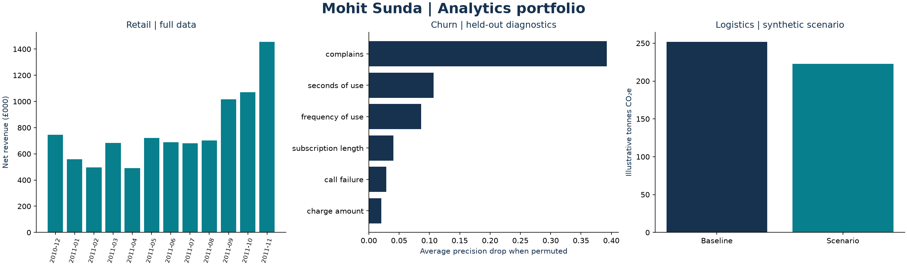

# Mohit Sunda

### Data Analyst | Business Analyst | BI Analyst

Edinburgh, Scotland. MSc Business Analytics and Consultancy, Heriot-Watt University, completed with merit.

I use Python, SQL, Power BI and Excel to investigate business questions, build useful reporting and turn evidence into practical decisions. My background includes data analysis at Savanta Analytics and projects in retail, customer behaviour and sustainable logistics.

## Featured projects

| Project | What it demonstrates | Explore |
| --- | --- | --- |
| UK retail performance | A source-to-dashboard pipeline across 541,909 public transaction records, with signed revenue reconciliation, customer segments and purchase activity cohorts | [Case study](projects/01_uk_retail/README.md) · [Notebook](notebooks/01_uk_retail.ipynb) · [SQL](src/portfolio/queries/retail.sql) |
| Customer retention intelligence | Baseline comparison, group-separated train/validation/test evaluation, capacity-aware review and CSV batch inference | [Case study](projects/02_customer_retention/README.md) · [Notebook](notebooks/02_customer_retention.ipynb) · [Model card](artifacts/full/churn_model_card.md) |
| Green logistics decision lab | Requirements, cost/service constraints and exact comparison of 256 lane-consolidation scenarios using clearly labelled synthetic data | [Case study](projects/03_green_logistics/README.md) · [Notebook](notebooks/03_green_logistics.ipynb) · [Business case](artifacts/full/logistics_business_case.md) |

[Browse the full repository](https://github.com/Mohitsunda/Mohitsunda) · [Run the projects](PORTFOLIO.md#run-locally) · [Data and metric definitions](docs/data_dictionary.md) · [Verification record](VERIFICATION.md)

## Technical toolkit

Python, pandas, NumPy, SQL, DuckDB, Power BI, Excel, scikit-learn, Streamlit and Git.

My work covers data cleaning, analytical SQL, dashboards, customer segmentation, model evaluation, requirements gathering and options appraisal. I am especially interested in analytics roles in financial services, logistics, retail and sustainability.

## Background

- MSc Business Analytics and Consultancy, Heriot-Watt University, completed with merit.
- B.E. Mechanical Engineering, SKIT, Rajasthan.
- Data Analyst at Savanta Analytics, November 2021 to July 2024.
- Dissertation focus: ESG and green logistics among UK SMEs.
- Certifications include Google Data Analytics, Python for Data Science, and Big Data Hadoop and Spark.

## Reproducible work

The portfolio includes a packaged Python CLI, executable SQL, an interactive dashboard, three executed notebooks, an offline demonstration, automated checks and deployment configuration. Local verification passed 20 tests. Hosted CI status is shown by the repository's [actual workflow runs](https://github.com/Mohitsunda/Mohitsunda/actions).

Public retail and telecom data are historical research sources. The logistics case is synthetic. These are independent portfolio studies, built with AI assistance and documented assumptions. Model scores and scenario projections are not claims of realised client impact.

[Technical project guide](PORTFOLIO.md) · [Architecture](docs/architecture.md) · [Power BI handoff](powerbi/README.md) · [Data attribution](DATA_LICENSE.md)
